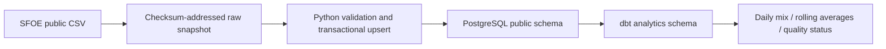

# Swiss Energy Intelligence Platform

A local Python -> PostgreSQL -> dbt pipeline for Swiss electricity-production data. This portfolio project demonstrates validation, source provenance, replay, SQL analytics and tested delivery. It is not a production monitoring service or evidence of professional cloud employment.

**Phases 1 and 2 are implemented and verified locally and in GitHub Actions. Phases 3-6 are planned.**

- [Documentation index and all phase guides](docs/INDEX.md)
- [Phase 1: setup, ingestion, configuration and recovery](docs/PHASE1.md)
- [Phase 2: dbt models, metric definitions and analytics validation](docs/PHASE2.md)
- [Validation evidence](docs/VALIDATION.md) and [incremental roadmap](docs/ROADMAP.md)
- [GitHub repository](https://github.com/PaddyLoeliger/swiss-energy-data-platform) and [Actions](https://github.com/PaddyLoeliger/swiss-energy-data-platform/actions)

## Start locally

The existing checkout is `C:\Projects\Swiss Energy Platform`:

```powershell
Set-Location 'C:\Projects\Swiss Energy Platform'
code .
```

For a new checkout on another machine, clone into an unused destination:

```powershell
git clone https://github.com/PaddyLoeliger/swiss-energy-data-platform.git 'C:\Projects\Swiss Energy Platform'
Set-Location 'C:\Projects\Swiss Energy Platform'
```

Use PowerShell 7 and a running Linux-container Docker engine with Compose v2. Host Python is optional. Follow the commands individually, checking the expected results in each phase guide:

```powershell
.\tasks.ps1 doctor
.\tasks.ps1 init
.\tasks.ps1 build
.\tasks.ps1 up
.\tasks.ps1 test
.\tasks.ps1 ingest
.\tasks.ps1 verify
.\tasks.ps1 analytics-test
.\tasks.ps1 analytics
.\tasks.ps1 quality
.\tasks.ps1 explain
```

`init` preserves an existing `.env`. Run `ingest` and `verify` a second time to validate replay. Stop without deleting data using `.\tasks.ps1 down`. The phase guides explain recovery and what persists.

## Architecture and boundaries



The verified snapshot contains 25,098 observations ending on 14 June 2026. On the validation date, 12 October 2026, it was 120 days old and contained one negative measurement. That value is retained and flagged. Missing or unsuitable inputs produce NULL derived metrics rather than misleading percentages. See the [source contract](docs/PHASE1.md) and [analytics rules](docs/PHASE2.md).

## Development and CI

Code is baked into Docker images. Rebuild ingestion with `build` after source edits; `analytics` and both test tasks rebuild their relevant image automatically. `.env`, raw data and generated dbt artifacts are excluded from Git. Docker volumes are separate from the repository.

[CI](.github/workflows/ci.yml) runs ingestion tests and the dbt correction/quality scenario sequentially on pushes and pull requests. It requires registry/package downloads but no live energy-source download. The workflow uses an isolated test database, generated ephemeral credentials and read-only GitHub repository permissions.

Before pushing, inspect `git status --short`, `git diff --cached` and `git check-ignore .env`. The public remote already exists; do not recreate it. Local setup does not require GitHub sign-in. Uploading workflow changes through GitHub CLI requires appropriate workflow authorization; local pipeline execution does not.
