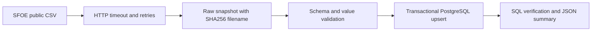

# Swiss Energy Intelligence Platform

The foundation is a local Python → PostgreSQL pipeline for daily Swiss electricity production. It demonstrates validation, transactional loads, repeatable execution, source corrections, provenance and CI. It is a portfolio project, not a production service or a claim of professional cloud experience.

## Phase 2: SQL/dbt analytics

Phase 2 adds daily totals, generation mix, seven-day rolling averages and a data-quality status view. Start with the [Phase 2 walkthrough and metric definitions](docs/PHASE2.md). After ingestion, run:

```powershell
.\tasks.ps1 analytics-test
.\tasks.ps1 analytics
.\tasks.ps1 quality
.\tasks.ps1 explain
```

Missing and negative measurements are visible; derived shares and averages are withheld when their inputs are unsuitable. Models rebuild in full so historical source corrections propagate reliably. CI exercises these behaviors against a separate test database.

## Data and architecture

Source: Swiss Federal Office of Energy (SFOE/BFE), **energiedashboard.ch: Stromproduktion Swissgrid**.

- [Official catalogue and current download link](https://opendata.swiss/de/dataset/energiedashboard-ch-stromproduktion-swissgrid/resource/0879ba1b-40ea-4e26-bba0-9cbb339f577e)
- [Federal CSV endpoint used here](https://www.uvek-gis.admin.ch/BFE/ogd/104/ogd104_stromproduktion_swissgrid.csv)
- [SFOE energy dashboard context](https://www.bfe.admin.ch/en/energy-dashboard)

The catalogue currently links to bfe-ogd.ch; that host intermittently reset connections during setup. The federal alternate endpoint above was reachable. Attribution belongs to SFOE/Swissgrid. Check the catalogue's current terms before redistributing data; snapshots are excluded from Git. Production is measured in **GWh per day and energy carrier**, not instantaneous power. No inference is made that the final date is today or that all carriers are complete.



Primary key: `(production_date, energy_carrier)`. Decimal values retain source precision. Every successful load has a timestamp, URL, checksum and row count. Replaying a file does not duplicate observations; subsequent source corrections replace previous values. Validation rejects empty input, missing required columns, duplicate keys, invalid dates and non-finite values before database writes. Extra columns are tolerated. Negative values are preserved verbatim and flagged `negative_source_value_review`; their meaning requires source clarification. Failed DB loads roll back the run record and all observations. Failed validation leaves the raw snapshot for investigation.

This phase downloads the **full snapshot**, not a true incremental feed. Deleted upstream records are not deleted locally. The latest run ID records last observation, not original creation. Raw snapshots and success logs accumulate; failed-run details are presently container stderr, not a durable audit table. Do not schedule overlapping loads. Credentials remain in environment variables; errors log their class only to avoid leaking connection details.

## Windows setup, one step at a time

Open PowerShell in this repository. Run each command separately and check its result before continuing. `tasks.ps1` works in Windows PowerShell 5.1 and PowerShell 7. If local script execution is blocked, invoke each task as `powershell -NoProfile -ExecutionPolicy Bypass -File .\tasks.ps1 <task>`; this applies to that process only.

1. **Check prerequisites**
   ```powershell
   .\tasks.ps1 doctor
   ```
   Expect Git and VS Code paths, Docker client/server versions, Compose v2 and `linux`. Start Docker Desktop or your existing Docker engine if the daemon is unavailable. Docker execution needs no host Python. Optional native development requires Python 3.12+; a WindowsApps alias alone is not proof of an installed interpreter. Use `python --version` to confirm.

2. **Open the project and create local configuration**
   ```powershell
   code .
   .\tasks.ps1 init
   git check-ignore .env
   ```
   Expect `.env` as the last output. Never add it to Git. `init` preserves existing credentials; do not change the password after a volume is initialized without updating PostgreSQL itself.

3. **Build the Python container**
   ```powershell
   .\tasks.ps1 build
   ```
   Expect successful image creation. First run downloads Python, PostgreSQL and pinned Python dependencies. Image tags receive upstream patches and are not digest-pinned yet.

4. **Start PostgreSQL**
   ```powershell
   .\tasks.ps1 up
   docker compose ps
   ```
   Expect `db` to be healthy. PostgreSQL is reachable only within this Compose network; existing host databases are unaffected.

5. **Run tests**
   ```powershell
   .\tasks.ps1 test
   ```
   Expect all tests passed with no skips. This uses a separate ephemeral database, including tests for replay, corrections and rollback. Unit tests mock network failures; CI never relies on the public source being online.

6. **Run the real pipeline and inspect it**
   ```powershell
   .\tasks.ps1 ingest
   .\tasks.ps1 verify
   .\tasks.ps1 ingest
   .\tasks.ps1 verify
   ```
   Expect `ingestion_complete`, then `verification_passed`. If the source snapshot is unchanged, the checksum and observation count remain the same after replay while the run ID increases. Check first/last dates rather than assuming data freshness.
   ```powershell
   docker compose exec db psql -U energy -d energy -c "SELECT energy_carrier, count(*), max(production_date) FROM electricity_production GROUP BY energy_carrier ORDER BY energy_carrier;"
   ```
   Adjust user/database if you changed their defaults. Expect one summary per source energy carrier.

7. **Stop without deleting data**
   ```powershell
   .\tasks.ps1 down
   ```
   Database and raw snapshots persist in named volumes. Avoid `down -v` unless deliberately deleting this project's stored data.

## Optional native Python development

```powershell
python -m venv .venv
.\.venv\Scripts\python.exe -m pip install -e ".[test]"
.\.venv\Scripts\python.exe -m pytest -m "not integration"
```

Integration tests run through Docker. Their fixture refuses databases whose names do not end in `_test` because it truncates test tables.

## GitHub

The local repository is independent of the surrounding Job Applications folder. `.github/workflows/ci.yml` runs containerized unit/integration tests on pushes and pull requests with read-only repository permissions. A remote Actions result can only be confirmed after publishing.

Before publishing, review `git status --short`, `git diff --cached` and `git check-ignore .env`. Stage explicit project files; never stage the surrounding job-search folder. Choose repository visibility before using `gh repo create`. No remote repository is created automatically by the setup script.

## Troubleshooting

- Engine unavailable: start your installed Docker engine, then rerun `doctor`.
- Download failure: retry ingestion; failed downloads do not alter PostgreSQL. Test the documented source endpoint in a browser. Do not disable TLS verification.
- `pipeline_failed`: error type is printed deliberately without secrets. `ValueError` generally means source validation failed; inspect the raw snapshot with the parser in a private debugging session. `OperationalError` usually means database connectivity/authentication. `URLError` indicates source/network trouble.
- Password failure after editing `.env`: restore the original local password or perform an explicit database password change. Recreating containers does not reset persisted credentials.
- Schema evolution: `CREATE TABLE IF NOT EXISTS` only initializes Phase 1; future column changes require migrations.

See [roadmap](docs/ROADMAP.md) and [verification record](docs/VALIDATION.md).
