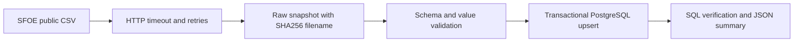

# Phase 1: Local ingestion foundation

Status: implemented; local pipeline and GitHub CI verified. [Validation evidence](VALIDATION.md).

## Objective and prerequisites

Ingest a real public Swiss electricity-production snapshot into PostgreSQL with validation, provenance and repeatable replay. Requires Git, a running Linux-container Docker engine and Compose v2; VS Code is the chosen editor. Host Python and GitHub CLI are optional for local container execution. The verified versions are historical observations in the validation record, not minimum supported versions.

## Data and architecture

Source: Swiss Federal Office of Energy (SFOE/BFE), **energiedashboard.ch: Stromproduktion Swissgrid**.

- [Official dataset catalogue](https://opendata.swiss/de/dataset/energiedashboard-ch-stromproduktion-swissgrid/resource/0879ba1b-40ea-4e26-bba0-9cbb339f577e)
- [Federal CSV endpoint used here](https://www.uvek-gis.admin.ch/BFE/ogd/104/ogd104_stromproduktion_swissgrid.csv)
- [SFOE energy dashboard context](https://www.bfe.admin.ch/en/energy-dashboard)

At the 12 October 2026 validation, the catalogue linked to bfe-ogd.ch; that host intermittently reset connections during setup. The federal alternate endpoint above was reachable. Attribution belongs to SFOE/Swissgrid. Check the catalogue's current terms before redistributing data; snapshots are excluded from Git. Production is measured in **GWh per day and energy carrier**, not instantaneous power. No inference is made that the final date is today or that all carriers are complete.



Primary key: `(production_date, energy_carrier)`. Decimal values retain source precision. Every successful load has a timestamp, URL, checksum and row count. Replaying a file does not duplicate observations; subsequent source corrections replace previous values. Validation rejects empty input, missing required columns, duplicate keys, invalid dates and non-finite values before database writes. Extra columns are tolerated. Negative values are preserved verbatim and flagged `negative_source_value_review`; their meaning requires source clarification. Failed DB loads roll back the run record and all observations. Failed validation leaves the raw snapshot for investigation.

This phase downloads the **full snapshot**, not a true incremental feed. Deleted upstream records are not deleted locally. The latest run ID records last observation, not original creation. Raw snapshots and successful database run records accumulate; failed-run details are presently container stderr, not a durable audit table. Do not schedule overlapping loads. Credentials remain in environment variables; errors log their class only to avoid leaking connection details.

## Windows setup, one step at a time

Open PowerShell in this repository. Run each command separately and check its result before continuing. `tasks.ps1` was exercised in PowerShell 7. Windows PowerShell 5.1 has not been separately validated; prefer PowerShell 7, particularly for commands containing nested quotes. If local script execution is blocked, invoke each task as `pwsh -NoProfile -ExecutionPolicy Bypass -File .\tasks.ps1 <task>`; this applies to that process only.

1. **Check prerequisites**
   ```powershell
   .\tasks.ps1 doctor
   ```
   Expect Git and VS Code paths, Docker client/server versions, Compose v2 and `linux`. Start Docker Desktop or your existing Docker engine if the daemon is unavailable. Docker execution needs no host Python. Optional native development requires Python 3.12+; a WindowsApps alias alone is not proof of an installed interpreter. Use `python --version` to confirm.

2. **Open the project and create local configuration**
   ```powershell
   code .
   .\tasks.ps1 init
   git check-ignore .env
   ```
   Expect `.env` as the last output. Never add it to Git. `init` preserves existing credentials; do not change the password after a volume is initialized without updating PostgreSQL itself.

3. **Build the application containers**
   ```powershell
   .\tasks.ps1 build
   ```
   Expect successful image creation. The current default build includes the ingestion and analytics images; PostgreSQL is pulled when its service starts. Direct Python dependencies are pinned, but transitive dependencies and image digests are not fully locked. These are reproducible workflows, not byte-for-byte reproducible environments.

4. **Start PostgreSQL**
   ```powershell
   .\tasks.ps1 up
   docker compose ps
   ```
   Expect `db` to be healthy. PostgreSQL is reachable only within this Compose network; existing host databases are unaffected.

5. **Run tests**
   ```powershell
   .\tasks.ps1 test
   ```
   Expect all tests passed with no skips. This uses a separate ephemeral database, including tests for replay, corrections and rollback. Unit tests mock network failures; CI never relies on the public source being online.

6. **Run the real pipeline and inspect it**
   ```powershell
   .\tasks.ps1 ingest
   .\tasks.ps1 verify
   .\tasks.ps1 ingest
   .\tasks.ps1 verify
   ```
   Expect `ingestion_complete`, then `verification_passed`. If the source snapshot is unchanged, the checksum and observation count remain the same after replay while the run ID increases. Check first/last dates rather than assuming data freshness.
   ```powershell
   docker compose exec db psql -U energy -d energy -c "SELECT energy_carrier, count(*), max(production_date) FROM electricity_production GROUP BY energy_carrier ORDER BY energy_carrier;"
   ```
   Adjust user/database if you changed their defaults. Expect one summary per source energy carrier.

7. **Stop without deleting data**
   ```powershell
   .\tasks.ps1 down
   ```
   Database and raw snapshots persist in named volumes. Avoid `down -v` unless deliberately deleting this project's stored data.

## Optional native Python development

```powershell
python -m venv .venv
.\.venv\Scripts\python.exe -m pip install -e ".[test]"
.\.venv\Scripts\python.exe -m pytest -m "not integration"
```

Integration tests run through Docker. Their fixture refuses databases whose names do not end in `_test` because it truncates test tables.

## Configuration and persistence

Run `init` rather than copying the example password verbatim. Compose reads the ignored `.env` at the repository root.

| Setting | Default / source | Meaning |
|---|---|---|
| `POSTGRES_DB` | `energy` | Local application database |
| `POSTGRES_USER` | `energy` | Local development database user |
| `POSTGRES_PASSWORD` | Generated by `init` | Required local secret; never commit or print it |
| `PGHOST`, `PGDATABASE`, `PGUSER`, `PGPASSWORD` | Mapped by Compose | Python/libpq connection settings |
| `RAW_DIR` | `/data/raw` in Compose | Raw snapshots stored as SHA256-named CSV files |
| `SOURCE_URL` | Constant in `src/energy_platform/pipeline.py` | Federal CSV endpoint; no CLI/environment override is implemented |

The download allows three attempts with one- and two-second waits, a 60-second HTTP timeout and a 20 MB response limit. Database connection timeout is ten seconds. These are code settings, not task arguments.

Repository files live under `C:\Projects\Swiss Energy Platform`. PostgreSQL and raw snapshots live in Docker-managed named volumes (`swiss-energy-data-platform_postgres_data` and `swiss-energy-data-platform_raw_data`), not in this folder. Moving or cloning the repository does not copy those volumes. The fixed Compose project name means multiple local clones share the same project unless deliberately configured otherwise; do not run independent clones concurrently.

The test database uses temporary container storage and is stopped by test tasks. No PostgreSQL host port is published. The application uses the database image's bootstrap user for this local demo; separate least-privilege ingestion/analytics roles are not implemented.

## Raw database contract

| Table | Field | Meaning |
|---|---|---|
| `public.ingestion_runs` | `id`, `loaded_at` | Successful transaction ID and database timestamp |
| | `source_url`, `sha256`, `row_count` | Origin, raw-byte digest and validated input count |
| `public.electricity_production` | `production_date`, `energy_carrier` | Composite primary key; source date and source category |
| | `production_gwh` | Exact decimal reported energy; negative values retained |
| | `run_id` | Last successful load touching this observation; foreign key to run metadata |
| | `quality_flag` | Generated `negative_source_value_review` or `not_flagged` |

The source date has daily grain and no timestamp/time-zone conversion. Production is energy in GWh, not power in GW. The raw table does not store every historical revision. A new full load updates matching keys, adds new keys and leaves keys absent from the new source untouched.

## Troubleshooting and recovery

- Engine unavailable: start the installed Docker engine and rerun `doctor`.
- `pipeline_failed` with `URLError` or a connection/timeout class: retry ingestion after connectivity returns. Downloads do not alter the database; do not disable TLS verification.
- `ValueError`: investigate the source schema/value or snapshot integrity. The CLI emits only the error class to avoid leaking connection details. Preserve the raw snapshot and use `parse_csv` in a private debugging session for its line-level exception; do not change source values merely to make a check pass.
- `OperationalError`: check database health and local credentials. Editing `.env` does not update the password in an initialized PostgreSQL volume. Restore the known credential or perform a deliberate database password change; do not delete the volume as a routine fix.
- A database write failure rolls back observations and run metadata together. Fix the cause, then rerun `ingest` and `verify`.
- `verify` reconciles the latest run's count against rows carrying that run ID. It does not prove freshness, complete category coverage or upstream deletion reconciliation; Phase 2 adds further checks.
- Python source is baked into the image: after an ingestion-code change, run `build` before `ingest`. Do not assume host edits are live-mounted.
- `CREATE TABLE IF NOT EXISTS` initializes tables only; it is not a migration framework.

Use `down` to stop services without removing named volumes and `up` to resume. There is no implemented backup/restore or offline-snapshot replay command. Do not treat a retained local volume as a tested backup. An interrupted raw-file write may leave a corrupt checksum-named file; ingestion detects the mismatch on reuse and stops, so investigate before retrying.

## Acceptance and test scope

The Phase 1 exit gate is a real download/load, successful SQL verification, repeat load without duplicate observations, passing unit/integration tests and a successful remote CI run. These passed on 12 October 2026; fixed row counts/date ranges in [VALIDATION.md](VALIDATION.md) describe that snapshot, not future required counts.

The 15 tests cover BOM/extra-column handling, invalid records and schema changes, HTTP retry recovery/exhaustion, database replay/correction, rollback and negative-value flagging. CI uses fixtures, not live public downloads. A green CI run therefore does not prove current source availability. Automated source discovery, migrations, retention, failure audit and concurrent-run handling are future work.

Next: [Phase 2 analytics](PHASE2.md). Return to the [documentation index](INDEX.md).
