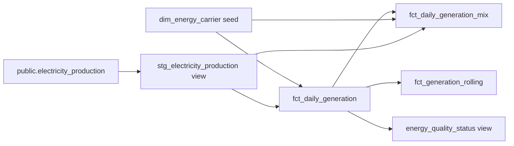

# Phase 2: SQL and dbt analytics

## Run and validate

From PowerShell in `C:\Projects\Swiss Energy Platform`, run each command separately:

```powershell
.\tasks.ps1 analytics-test
.\tasks.ps1 analytics
.\tasks.ps1 quality
.\tasks.ps1 explain
```

- `analytics-test`: builds the pinned dbt image and runs a PostgreSQL integration scenario. It performs three complete dbt builds and an intentional failing contract test. Expect `1 passed`; a failure prints captured dbt output. It uses only `energy_test`, never the application data.
- `analytics`: rebuilds the image as needed and runs `dbt build` against your ingested data. Expect no errors. Warnings about stale data and negative values are deliberate; a successful build does not mean the source is fresh or error-free.
- `quality`: displays source date coverage, source age, incomplete days and negative-value days. Run this after each ingestion and transformation. Ingestion alone does not refresh analytics tables.
- `explain`: executes two read-only `EXPLAIN (ANALYZE, BUFFERS)` examples. It measures actual query execution; timings depend on cache and hardware.

For a fresh clone, follow README initialization and ingestion first. The raw tables must exist before dbt runs. All dbt authentication comes from environment variables; the committed profiles file contains no password. dbt uses its `DBT_ENV_SECRET_` prefix to redact the password in logs.

## Models and grain



All dbt relations live in `analytics`, separate from the ingestion tables in `public`.

| Model | Grain | Use |
|---|---|---|
| `dim_energy_carrier` | One of six reviewed source categories | Expected category contract and English labels |
| `stg_electricity_production` | Observed day/carrier | Preserve reported GWh, negative flag and source run |
| `fct_daily_generation` | Every calendar day in source range | Total, completeness and usability |
| `fct_daily_generation_mix` | Every calendar day × expected carrier | Nullable GWh and generation share (fraction, not percent) |
| `fct_generation_rolling` | Every calendar day in source range | Seven-day average of daily usable total GWh |
| `energy_quality_status` | One row | Freshness and aggregate quality status |

## Explicit data rules

The expected carriers are Flusskraft, Kernkraft, Photovoltaik, Speicherkraft, Thermische and Wind. These are observed source categories, not a renewable/non-renewable classification. In particular, this project does not assume that all thermal generation is fossil or renewable.

1. Completeness means exactly the six reviewed carriers for a date. A new carrier fails the relationship test and requires an explicit contract update.
2. The date spine spans the source minimum through maximum. A missing interior day appears with zero observed carriers and NULL production, never fabricated zero production. Missing leading or trailing days cannot be inferred from this file alone.
3. A usable day must be complete and contain no negative values. Raw signed measurements are preserved. Flagged days retain `reported_total_gwh`, but `usable_total_gwh` and all shares are NULL.
4. A complete zero-total day is usable with total zero, but shares remain NULL because division by zero has no valid interpretation.
5. Shares divide by that day's complete, non-negative, positive total. Fractions sum to one within numeric tolerance; multiply by 100 only for display.
6. A rolling average covers the current calendar day plus the preceding six. It appears only when all seven days exist and are usable. Short initial windows and any missing/flagged day produce NULL, not an average over fewer available rows.
7. Freshness compares the latest observation date with PostgreSQL `current_date`, not the last download timestamp. The seven-day threshold is a project policy, not an asserted source SLA. Override with `dbt build --vars '{max_source_age_days: 14}'` if intentionally adopting another policy.

Freshness and known negative/incomplete source days are warning-level dbt tests so historical analysis can run. Empty data, duplicate grains, missing provenance, unknown categories and broken share/rolling invariants fail the build. Warnings must remain visible in demonstrations.

## Corrections, performance and limits

Tables are rebuilt in full. With approximately 25,000 source rows, this is inexpensive and avoids incremental-watermark errors when historical values change. The integration scenario corrects the first day's Wind value from 10 to 17 GWh, replays the correction, and confirms the total changes from 60 to 67, the day-seven rolling average from 60 to 61, and day-eight remains 60 because the corrected day is outside its window. It also asserts corrected shares and stable row counts.

The scenario then checks a wholly missing day, a missing carrier, a negative measurement and a zero-total day. Finally it deliberately adds an unknown carrier and requires dbt to fail its relationship contract. CI runs without a public-network data dependency.

Unique date indexes support narrow range queries. The mix model uses a compound `(production_date, energy_carrier)` index because date filters are the demonstrated access pattern. A broad sum by carrier must read most rows; PostgreSQL may appropriately choose a sequential scan and hash aggregate. An index is not automatically faster. Compare actual rows, buffer hits/reads and execution time in `explain`; do not force index scans or claim performance gains without measurement.

dbt builds individual relations, not one transaction over the entire graph. A failed build can leave a mix of previous and newly built relations. This local phase assumes one ingestion/transformation run at a time and no readers during a failed deployment. Later orchestration and deployment phases should address concurrency and atomic publication. There is no deletion reconciliation in the ingestion layer, no cloud deployment and no Airflow scheduler yet.

dbt build artifacts/logs live in the disposable container's `/tmp` and are excluded from Git when produced locally. Persistent artifact retention and a served dbt catalogue are future improvements. Model and source descriptions are committed in `analytics/models/schema.yml`.

References: [PostgreSQL adapter setup](https://docs.getdbt.com/docs/local/connect-data-platform/postgres-setup), [dbt data tests](https://docs.getdbt.com/docs/build/data-tests).

## Observed local validation — 12 October 2026

- dbt Core 1.12.5, dbt-postgres 1.11.0, PostgreSQL 16; Docker images built successfully.
- Original ingestion tests: 15 passed. Analytics integration scenario: 1 passed (three dbt builds plus intentional unknown-category rejection).
- Real dataset build: five models and one seed created; 26 data tests yielded 24 passes and two deliberate warnings. No errors or skipped nodes.
- Daily and rolling models: 4,183 rows each. Generation mix: 25,098 rows. No incomplete days; one negative-value day; source age 120 days.
- Full carrier aggregation: sequential scan of 25,098 rows, hash aggregate into six groups, 384 shared buffer hits, 11.140 ms execution.
- Seven-day date filter: bitmap index/heap scan, 42 rows, two shared buffer hits and two reads, 0.095 ms execution.

These are single local observations, not benchmarks or guaranteed timings. PostgreSQL row estimates differed from actual rows on freshly rebuilt tables; automatic statistics collection and caching can change subsequent plans. Both command outputs were inspected directly.
